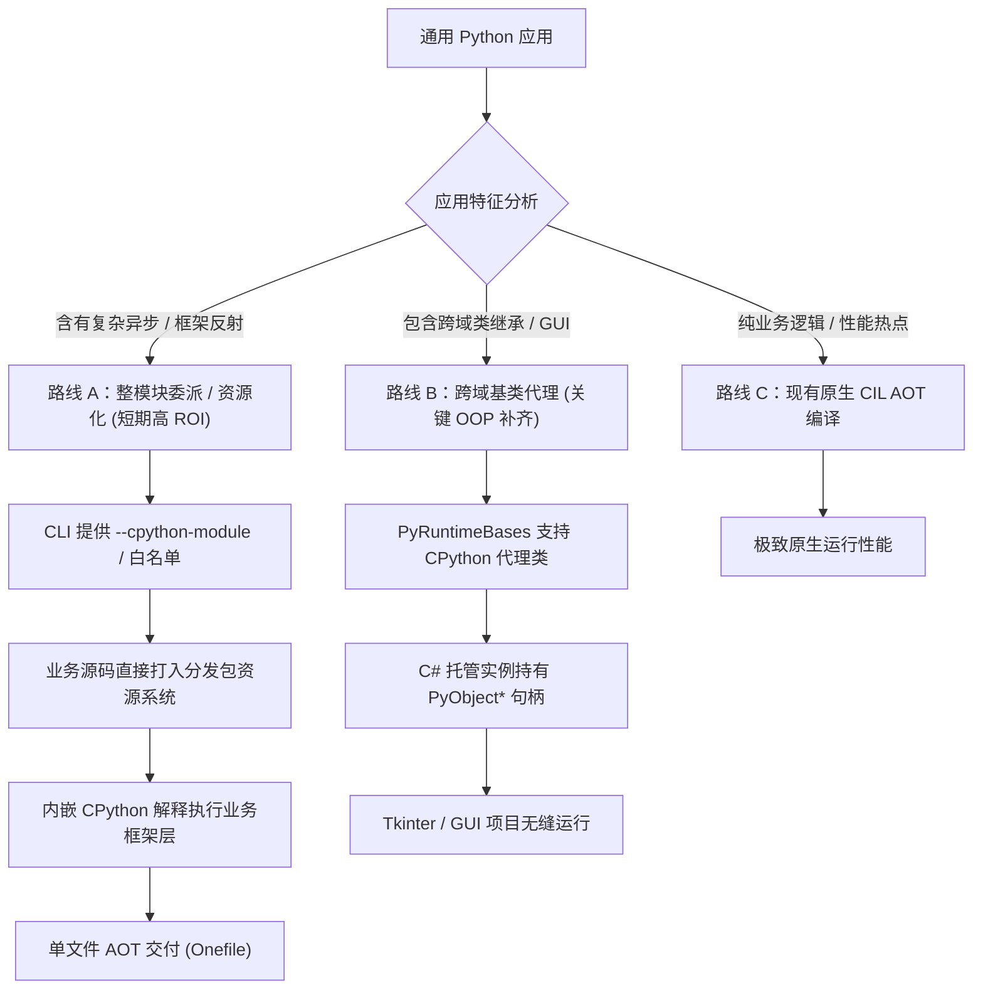

# RyuPy 通用项目兼容性缺口与演进分析报告

> 2026-11-16 后续长期方向已登记为[全 CIL 执行与 libpython 底层化](cil-execution-roadmap.md)
> （ADR-0208）：本报告的源码委派作为已验收兼容基线保留，未来通过 C0–C5 逐步迁移并退出。
> 新执行路径尚未实施，后文的项目成绩与已完成切片保持原范围。


## 2026-11-16 补齐与验收

本报告后文保留发现缺口时的证据与长期方向。本轮已实施路线 A/B/C：

- 显式 `--cpython-entry`、可重复 `--cpython-module` 与 `--cpython-dynamic-module`。
  委派源码随包执行，未声明模块继续编译；缺依赖或不支持语法明确报错。
- 编译用户类可继承真实 CPython 类型，实例分配、方法回调、描述符及 super 经中性桥处理。
  `tk.Tk` 本身为 Python 类，其内部 `_tkinter.tkapp` 由 CPython 管理。
- 发布扫描精确忽略 `.DS_Store` / `Thumbs.db` 普通文件；链接及非精确旁件仍检查。
  布局移除普通文件摘要流程，保留元数据与权限检查、旧 owner 迁移。
- Tcl/Tk 资源按分发根定位；宿主记录、隔离并恢复环境。编译模块源码随包保存为数据，
  `__file__` 从产品根解析；合法 wheel 构建头文件单独登记，macOS universal2 加载边正确解析。
- .NET 最低要求 10，正式主版本向上运行；本轮在仅安装 .NET 11 的主机完成。

macOS arm64 的同次 CPython 行为合同和删除输入搬迁均已执行：

| 真实项目 | JIT | standalone NativeAOT | onefile NativeAOT | 验证行为 |
| --- | --- | --- | --- | --- |
| FastAPI RESTful（CPython 3.13.3） | 通过 | 通过 | 通过 | ASGI 请求、OpenAPI、Pydantic、异步会话、SQLite CRUD、缓存 |
| SanBudget（CPython 3.12.13，原业务编译） | 通过 | 通过 | 通过 | macOS 真窗口、按钮回调、表单、Treeview、SQLite 新增编辑 |

驱动、固定依赖及具体边界见 [真实项目验收](../tests/general_projects/README.md)。
FastAPI 未运行外部 Uvicorn TCP 部署；SanBudget 未覆盖文件选择器和导出交互；
Windows/Linux 本轮未验。原生 async 状态机、完整原生元类/反射仍为长期任务；
已委派行为计入产品功能兼容率，原生执行率单列，固定二十项目矩阵保留。
设计见 ADR-0204、0205、0206、0207。

本报告基于两个真实项目（现代异步 Web 项目 `python-samples-fastapi-restful` 与 桌面 GUI 项目 `SanBudget`）在当前 RyuPy Release 编译器的实际打包构建与运行测试结果，结合 RyuPy 核心源码实现（Rust 编译器前端/中端、C# 运行时、CPython Provider 互操作桥及 NativeAOT 流水线），系统梳理当前通用 Python 项目在 RyuPy 上的**核心兼容性缺口**、**底层成因**与**架构演进路线**。

---

## 一、真实项目实测证据与卡点归因

### 1. 案例 A：FastAPI 异步 RESTful 服务 (`python-samples-fastapi-restful`)
- **技术栈**：Python 3.13、FastAPI、SQLAlchemy (AsyncSession)、aiocache、aiosqlite、Uvicorn。
- **构建命令**：
  ```bash
  ryupy /Users/laull/Temp/python-samples-fastapi-restful/main.py -o dist
  ```
- **实测阻断点**：
  1. **前端语法直接拦截**：
     在编译本地模块 `databases/player_database.py` 时触发中断：
     ```text
     [E0100] Error: 暂不支持 `async with`
         ╭─[ databases/player_database.py:61:5 ]
      61 │ ╭─▶     async with async_sessionmaker() as async_session:
      62 │ ├─▶         yield async_session
         │ ╰───────────────────────────────── 目前只支持同步上下文管理器
     ```
  2. **语法树降级限制**：
     源码中大量使用的 `await <expr>` 表达式被硬编码拒绝：
     ```text
     [E0100] Error: 暂不支持该表达式 (Phase 1 暂不支持该语法)
     ```
  3. **生态契约缺失**：
     即便前端放行语法，中端 MIR 缺少异步状态机（`Terminator::Await`），C# 运行时也缺乏与 Python `asyncio` 事件循环双向挂起/唤醒的协议桥。

---

### 2. 案例 B：Tkinter 桌面记账应用 (`SanBudget`)
- **技术栈**：Python 3.10+、纯标准库（Tkinter、ttk、SQLite3、csv、datetime）。
- **构建命令**：
  ```bash
  ryupy /Users/laull/Temp/SanBudget/app.py --mode standalone -o /tmp/sanbudget-dist
  ```
- **实测阻断点**：
  1. **构建阶段（平台旁件干扰）**：
     当输出目标为本地普通目录时，macOS Finder 自动创建的 `.DS_Store` 会导致严格快照核验失败：
     ```text
     error: 复制发布树期间内容或权限变化
     ```
     *成因*：`aot_layout_files.rs` 中的整树一致性快照未忽略操作系统临时/元数据文件。
  2. **运行阶段（跨域原生类继承崩溃）**：
     规避旁件生成二进制后，启动应用程序时直接崩溃：
     ```text
     Traceback (most recent call last):
       File "app.py", line 77, in <module>
     NotImplementedError: runtime bases currently require an ordinary user class;
     special classes and metaclass protocols are not supported
     ```
     *成因*：`app.py` 定义了 `class ExpenseTracker(tk.Tk):`。在 `PyRuntimeBases.cs` 中，RyuPy 在通过 CIL 构造类时严格要求基类必须是纯用户类（`PyClass`）或少数已特化的内建（`str`, `list`, `dict`, `object`）。当基类为来自 CPython Provider 的代理对象（如 C 扩展类 `tk.Tk`、PyQt `QWidget`、SQLAlchemy `BaseModel`）时，运行时直接拒绝继承。

---

## 二、通用项目兼容性缺口全景图谱

通用 Python 项目迁移或打包至 RyuPy 时，主要受阻于以下五大核心维度：

```
                    通用 Python 项目兼容性缺口
 ┌─────────────────┬─────────────────┬─────────────────┬─────────────────┐
 │   语法与控制流   │    面向对象      │   动态反射与     │    标准库与     │
 │  (Syntax/Async) │  (OOP / Types)  │ 元编程 (Meta)   │ 运行时调度(RT)  │
 ├─────────────────┼─────────────────┼─────────────────┼─────────────────┤
 │ • async/await   │ • 继承 CPython类│ • inspect/反射   │ • asyncio 事件循环│
 │ • async with/for│ • 元类 (metaclass│ • eval / exec   │ • sys._getframe │
 │ • 模式匹配 match│ • 复杂多重继承  │ • 动态 setattr   │ • CPython GIL/  │
 │ • 海象表达式 := │ • 自定义描述符  │ • __all__ / 钩子 │   线程重入状态  │
 └─────────────────┴─────────────────┴─────────────────┴─────────────────┘
```

### 1. 语法与控制流层（编译器前端 / 中端阻断）
- **异步控制流（Async / Await）**：
  - `await`、`async with`、`async for`、异步推导式、异步生成器。
  - **影响范围**：FastAPI、Sanic、Tornado、Aiohttp、HTTPX 等全部现代异步 Web / 爬虫应用。
- **结构化模式匹配（Pattern Matching）**：
  - Python 3.10+ 引入的 `match / case` 语句。
- **赋值表达式（Walrus Operator）**：
  - `if (n := len(data)) > 0:` 在部分 HIR 作用域中仍被明确拒绝。

### 2. 面向对象与类型系统层（对象模型阻断）
- **跨域类继承（Subclassing CPython Types）**：
  - **核心痛点**：用户类继承自 CPython 模块导出的类型（如 `class App(tk.Tk)`、`class Window(QMainWindow)`、`class Item(pydantic.BaseModel)`）。
  - **底层难点**：CIL 类实例分配在 .NET 托管堆，而 CPython C 扩展类要求其底层内存包含 `PyObject_HEAD` 结构体，目前缺乏托管字段与 C 结构体内存复合排布的互操作包装。
- **元类协议（Metaclass）与类构建钩子**：
  - 自定义 `metaclass`、`__init_subclass__`、`__class_getitem__`。
  - **影响范围**：Pydantic、Django Models、SQLAlchemy Declarative Base、ABC 抽象基类。
- **描述符协议（Descriptors）**：
  - 自定义属性描述符（`__get__`, `__set__`, `__delete__`）在跨域和 CIL 编译类中的完整触发协议。

### 3. 动态特性与元编程（框架级阻断）
- **代码内省与函数签名（`inspect` 模块）**：
  - 依赖注入框架（FastAPI `Depends`、Pytest Fixtures、Click / Typer CLI）高度依赖 `inspect.signature` 读取函数的参数名、类型标注（`__annotations__`）和默认值。CIL 编译后的方法若未完整暴露 Python 层反射元数据，会导致框架依赖注入失败。
- **动态栈帧与 Traceback（Stack Frame Reflection）**：
  - `sys._getframe()`、`inspect.currentframe()` 在 NativeAOT 编译环境下无法模拟真实的 Python 运行时调用栈，影响日志库（如 `loguru`）和调试/测试工具。
- **动态代码求值（Dynamic Execution）**：
  - `eval()`, `exec()`, `compile()`。常用于模板引擎（Jinja2、Mako）或序列化映射器。

### 4. 运行时生态与外部系统
- **`asyncio` 事件循环调度**：
  - .NET Task/ThreadPool 线程模型与 Python GIL/asyncio Loop 的协作。
- **GUI 资源与动态链接**：
  - 如 Tkinter 运行时需正确加载平台 `_tkinter` 模块，并自动配置 `TCL_LIBRARY` / `TK_LIBRARY` 资源目录路径。
- **打包基础设施健壮性**：
  - AOT 布局快照应主动过滤平台临时文件（macOS `.DS_Store`、Windows `Thumbs.db`）。

---

## 三、通用项目分类支持现状矩阵

| 项目分类 | 典型代表 | 当前在 RyuPy 上的主要卡点 | 支持成熟度 | 演进建议 |
| :--- | :--- | :--- | :---: | :--- |
| **纯计算 / 脚本 / CLI** | 离线计算、密码学、文本解析、数学模型 | 无严重阻断（若使用标准同步语法） | **高** | 充分发挥 RyuPy NativeAOT 高性能与快速启动优势。 |
| **传统同步 Web** | 基础 Flask、Bottle、Requests 脚本 | 依赖库中的动态反射及 CPython Provider 配置 | **中等** | 补全涉及的 CPython 标准库代理及资源打包。 |
| **桌面 GUI 应用** | [SanBudget](file:///Users/laull/Temp/SanBudget/app.py) (Tkinter)、PyQt、WxPython | **卡在继承原生窗口类** (`class App(tk.Tk)`) | **中低** | **优先攻关跨域类继承**；或业务侧采用组合模式（`self.root = tk.Tk()`）。 |
| **现代异步 Web / 微服务** | [FastAPI](file:///Users/laull/Temp/python-samples-fastapi-restful/main.py)、Sanic、Tornado | **卡在 `async/await` 语法及事件循环调度** | **低** | 建议短期采用 **“整模块委派（源码资源化）”**；长期演进原生异步状态机。 |

---

## 四、架构演进路径与解决方案建议

针对上述两类核心痛点，建议在后续版本中推进两条互补路线：



### 建议 1：支持本地模块“整模块委派（CPython Module Delegation）”（短期 ROI 最高）
- **背景**：在 `docs/cpython-provider.md` 第 3 节中，架构设计本身已明确预留：*“未来整模块委派须显式声明和单独验收”*。
- **方案**：
  - 允许在构建时声明指定本地模块（或自动检测语法不兼容模块）**不编译为 CIL**，而是作为 Python 源码模块打包进分发包的内部虚拟资源树中。
  - RyuPy 仅负责编译入口启动器（Launcher）或原生计算热点，复杂框架（如 FastAPI + Uvicorn）完整由内嵌的 CPython 运行时解释执行。
  - **价值**：无需耗费数月重构异步状态机与反射系统，即可立即实现将复杂的 FastAPI、Django、Pandas 等项目打包为**免安装环境、单文件（Onefile）交付**的独立可执行程序。

### 建议 2：突破“跨域类继承”限制（解锁 Tkinter / GUI 生态）
- **方案**：
  - 扩展 `PyRuntimeBases.Validate` 与 `PyClass.MakeClassCore`，当基类是来自 CPython Provider 的类型对象时：
    1. 允许继承，并在 C# 运行时为其实例绑定关联的底层 `PyObject*` C 结构体句柄。
    2. 在 `super().__init__()` 调用时，通过互操作桥触发 CPython 端基类的 `tp_init` / `__init__`。
  - **价值**：直接解决 SanBudget 以及绝大多数基于 Tkinter、PyQt、CustomTkinter 的桌面 GUI 工具在 RyuPy 上的运行问题。

### 建议 3：AOT 布局文件扫描增强
- **方案**：在 `crates/ryupy-driver/src/aot_layout_files.rs` 中，对 `.DS_Store`、`Thumbs.db` 以及临时目录锁文件加入默认忽略规则，避免非代码旁件导致发布树核验中断。
